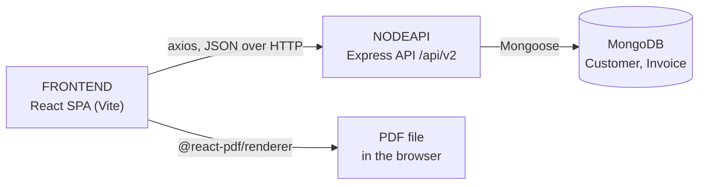

# Architecture Design

Last updated: 2026-10-28

## Structure

Three npm projects in one repository, with no workspaces: the root holds only the scripts that start the other two together.

```text
InvoiceMe/
├── .github/
│   └── workflows/
├── FRONTEND/
│   ├── public/
│   └── src/
│       ├── assets/
│       ├── components/
│       ├── config/
│       ├── pages/
│       └── utils/
└── NODEAPI/
    ├── controllers/
    ├── middlewares/
    ├── models/
    ├── routes/
    ├── scripts/
    ├── tests/
    └── utils/
```

## Key files

### ./
- package.json: dev scripts only, which start the API and the frontend together

### .github/
- workflows/node.js.yml: CI on pushes and pull requests to `master`; lints and builds the frontend on Node 22.x and 24.x, and on Node 24.x only syntax-checks the API, loads `app.js` without a database, and runs the API tests (`npm test`) on an in-memory MongoDB (the API tests need Node 24.9+, see `tests/` below)
- workflows/codeql.yml: CodeQL code scanning
- dependabot.yml: weekly npm updates for `FRONTEND` and `NODEAPI`, monthly for GitHub Actions
  - Accepted dev-only findings in `NODEAPI/` (`npm audit`, checked 2026-11-14): `glob` and `minimatch` (under `jest` and `nodemon`; fixed only in new majors that those tools don't declare yet, and `jest` and `nodemon` are on their latest releases) and `deepmerge` (under `jest-config`; no fixed release exists). All three are development tooling that is never shipped or run in production. Revisit when `jest` or `nodemon` release an update. `npm audit fix --force` is not used: it would downgrade `jest` to 25 and break the suite

### FRONTEND/
React single-page app built with Vite (ES modules), styled with Tailwind.
- src/main.jsx: mounts the app inside `BrowserRouter`
- src/App.jsx: the routes, the navigation bar and the toast container
- src/config/apiConfig.js: every API endpoint URL, as `API_ENDPOINTS`, built from `VITE_API_BASE_URL`
- src/utils/phone.js: the phone check (the server's pattern, ADR-003) and the `(555) 123-4567` display format
- src/utils/date.js: the date-of-service check (the server's rule, ADR-003), the `MM/DD/YYYY` display format and the month, all read from the `YYYY-MM-DD` string without parsing it into a `Date` (ADR-013)
- src/utils/money.js: the dollars-to-cents parsers (the server's rules, ADR-003), the display-only line total and the `$1,234.56` display format; amounts are integer cents everywhere else (ADR-012)
- src/utils/customers.js: `fetchAllCustomers`, which walks every page of `GET /api/v2/customers` (100 a page, the server's cap) and returns one array; the home page and the invoice picker use it
- src/pdfStyle.jsx: styles for the PDF invoice
- eslint.config.js: ESLint flat config

### FRONTEND/src/pages/
One file per route.
- HomePage.jsx: `/`, the customer cards (20 to a page, with a page control) and the invoice table
- CreatePage.jsx: `/create`, a new customer
- EditPage.jsx: `/edit/:id`, an existing customer
- InvoicePage.jsx: `/invoice`, the invoice form: customer, line items, tax
- PdfPage.jsx: `/pdfPage`, the invoice preview, where it is saved and downloaded as a PDF
- ProfilePage.jsx: `/profilePage/:id`, one customer and their invoices

### FRONTEND/src/components/
- PdfDocument.jsx: the invoice PDF, rendered in the browser with `@react-pdf/renderer`
- Customer.jsx, CustomerInfo.jsx, CustomerProfile.jsx: customer cards and details
- TableCustomer.jsx, TableInvoice.jsx, TableDescription.jsx: the customer, invoice and line-item tables

### NODEAPI/
Express API (CommonJS) over MongoDB with Mongoose.
- server.js: loads `.env`, connects to MongoDB, builds the customer and invoice unique indexes (it exits if it cannot), then listens (port 3000 by default)
- app.js: builds the Express app, CORS, the sign-in check on `/api/v2/`, routes, the 404 handler and the error handler; it has no side effects, so it loads without a database or a network call
- .env.example: the environment variables to copy into `.env`, including the four `ENTRA_*` sign-in variables (ADR-014)
- scripts/v2Migration.js: the one-off data migration to the v2 shapes (`npm run migrate:v2`, `--dry-run` first); it reads and writes the raw collections, is run by hand and is never loaded by `app.js` or `server.js`
- tests/: the Jest + Supertest suite (`npm test`), run against an in-memory MongoDB; its setup is in `tests/setup/`. Jest loads the ESM-only `jose` through `require()`, which needs Node 24.9+ and `--experimental-vm-modules` (set in the `npm test` scripts). The setup also generates a signing key, serves its public half from a loopback JWKS and signs the test tokens (`tokenHelper.js`, `authedRequest.js`), so no test calls Entra

### NODEAPI/routes/
One router per resource under `/api/v2/`: customerRoute.js, invoiceRoute.js, taxRoute.js.

### NODEAPI/controllers/
One controller per router: customerController.js, invoiceController.js, taxController.js.

### NODEAPI/models/
- customerModel.js: the Customer collection
- invoiceModel.js: the Invoice collection; an invoice stores a copy of the customer's fields, not a reference to the customer, and its money as integer cents with `lineItems`

### NODEAPI/middlewares/
- authMiddleware.js: on every `/api/v2/` request, verifies the Entra access token (signature, issuer, audience, expiry, scope, `oid`) and sets `req.user.id`; answers 401 `Sign-in required`, or 500 when its configuration or the key set is unavailable (ADR-014)
- validationMiddleware.js: runs the validators on a request body before the controller
- errorMiddleware.js: turns any error into the JSON error response

### NODEAPI/utils/
- validators.js: the server's validation rules
- money.js: the integer-cent math (line total, tax, final price) behind `postInvoice` and `/tax/calculate`
- errors.js: the error classes, each with its HTTP status
- constants.js: the state tax-rate table and the response messages

## Overview



The project runs locally only: the API on port 3000 and the frontend on Vite's dev server.

How data moves through these parts: [Data Flow](DataFlow.md)
