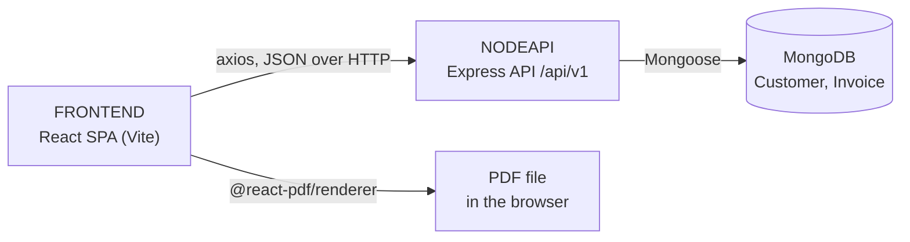

# Architecture Design

Last updated: 2026-10-26

## Structure

Three npm projects in one repository, with no workspaces: the root holds only the scripts that start the other two together.

```text
InvoiceMe/
├── .github/
│   └── workflows/
├── FRONTEND/
│   ├── public/
│   └── src/
│       ├── assets/
│       ├── components/
│       ├── config/
│       └── pages/
└── NODEAPI/
    ├── controllers/
    ├── middlewares/
    ├── models/
    ├── routes/
    ├── tests/
    └── utils/
```

## Key files

### ./
- package.json: dev scripts only, which start the API and the frontend together

### .github/
- workflows/node.js.yml: CI on pushes and pull requests to `master`; lints and builds the frontend, syntax-checks the API, loads `app.js` without a database, and runs the API tests (`npm test`) on an in-memory MongoDB
- workflows/codeql.yml: CodeQL code scanning
- dependabot.yml: weekly npm updates for `FRONTEND` and `NODEAPI`, monthly for GitHub Actions

### FRONTEND/
React single-page app built with Vite (ES modules), styled with Tailwind.
- src/main.jsx: mounts the app inside `BrowserRouter`
- src/App.jsx: the routes, the navigation bar and the toast container
- src/config/apiConfig.js: every API endpoint URL, as `API_ENDPOINTS`, built from `VITE_API_BASE_URL`
- src/pdfStyle.jsx: styles for the PDF invoice
- eslint.config.js: ESLint flat config

### FRONTEND/src/pages/
One file per route.
- HomePage.jsx: `/`, the customer list
- CreatePage.jsx: `/create`, a new customer
- EditPage.jsx: `/edit/:id`, an existing customer
- InvoicePage.jsx: `/invoice`, the invoice form: customer, line items, tax
- PdfPage.jsx: `/pdfPage`, the invoice preview, where it is saved and downloaded as a PDF
- ProfilePage.jsx: `/profilePage/:id`, one customer and their invoices

### FRONTEND/src/components/
- PdfDocument.jsx: the invoice PDF, rendered in the browser with `@react-pdf/renderer`
- Customer.jsx, CustomerInfo.jsx, CustomerProfile.jsx: customer cards and details
- TableCustomer.jsx, TableInvoice.jsx, TableDescription.jsx: the customer, invoice and line-item tables

### NODEAPI/
Express API (CommonJS) over MongoDB with Mongoose.
- server.js: loads `.env`, connects to MongoDB, then listens (port 3000 by default)
- app.js: builds the Express app, CORS, routes, the 404 handler and the error handler; it has no side effects, so it loads without a database
- .env.example: the environment variables to copy into `.env`
- tests/: the Jest + Supertest suite (`npm test`), run against an in-memory MongoDB; its setup is in `tests/setup/`

### NODEAPI/routes/
One router per resource under `/api/v1/`: customerRoute.js, invoiceRoute.js, taxRoute.js.

### NODEAPI/controllers/
One controller per router: customerController.js, invoiceController.js, taxController.js.

### NODEAPI/models/
- customerModel.js: the Customer collection
- invoiceModel.js: the Invoice collection; an invoice stores a copy of the customer's fields, not a reference to the customer

### NODEAPI/middlewares/
- validationMiddleware.js: runs the validators on a request body before the controller
- errorMiddleware.js: turns any error into the JSON error response

### NODEAPI/utils/
- validators.js: the server's validation rules
- errors.js: the error classes, each with its HTTP status
- constants.js: the state tax-rate table and the response messages

## Overview



The project runs locally only: the API on port 3000 and the frontend on Vite's dev server.

How data moves through these parts: [Data Flow](DataFlow.md)
