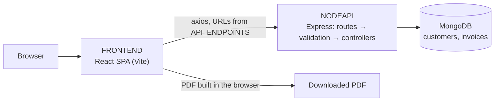

# Architecture Design

Last updated: 2026-10-20

InvoiceMe is three npm projects in one repository, with no workspaces: a React single-page app, an Express API, and a root `package.json` that only holds the scripts to start both together.

## Structure

```text
InvoiceMe/
├── .github/
│   └── workflows/          CI (lint, build, API smoke test) and CodeQL
├── FRONTEND/               React 19 SPA, built with Vite, styled with Tailwind CSS 4
│   ├── public/
│   └── src/
│       ├── assets/
│       ├── components/
│       ├── config/
│       └── pages/
├── NODEAPI/                Express 5 API on Mongoose 9 (CommonJS)
│   ├── controllers/
│   ├── middlewares/
│   ├── models/
│   ├── routes/
│   └── utils/
├── Docs/                   Project documents: vision, roadmap
└── Harness_Config/         Context documents for the AI agent
```

## Key files

### Root
- `package.json`: helper scripts only. `npm run dev` starts the API, waits for `/health`, starts Vite, then opens the browser.
- `README.md`: setup and how to run locally.

### NODEAPI/
- `app.js`: builds the Express app (CORS, JSON parsing, routes, 404 handler, error middleware) with no side effects on require: no database connection and no listening port. CI checks this.
- `server.js`: loads `.env`, connects to MongoDB, then starts listening. Falls back to a local MongoDB when `MONGO_URL` is unset.
- `.env.example`: the environment variables the API expects. The real `.env` is gitignored.

### NODEAPI/routes/
- `customerRoute.js`: `/api/v1/customers`, with list (paginated), get by ID, create, update and delete
- `invoiceRoute.js`: `/api/v1/invoices`, with list, create and delete
- `taxRoute.js`: `/api/v1/tax`, with `POST /rate` (a state's rate) and `POST /calculate` (tax and final price)

### NODEAPI/controllers/
- `customerController.js`, `invoiceController.js`, `taxController.js`: one handler per route, each wrapped in `asyncHandler`. The customer controller rejects a duplicate phone number on create and update.

### NODEAPI/middlewares/
- `validationMiddleware.js`: runs the validators from `utils/validators.js` on customer create and update and invoice create, and turns failures into a `ValidationError`.
- `errorMiddleware.js`: the error handler for every route. It logs the error and answers with the error envelope. Unknown routes get the separate 404 handler in `app.js`.

### NODEAPI/models/
- `customerModel.js`: Customer, with the company, contact and address fields.
- `invoiceModel.js`: Invoice. It carries its own copy of the customer's contact and address fields, with no reference to the Customer, plus the job fields, the line items (`tableData`), the tax rate, the subtotal and the final price.

### NODEAPI/utils/
- `errors.js`: `AppError` and its subclasses, each with its HTTP status: `ValidationError` (400), `UnauthorizedError` (401), `NotFoundError` (404), `ConflictError` (409), `InternalServerError` (500).
- `validators.js`: the regex patterns and the validators for customer and invoice data.
- `constants.js`: `STATE_TAX_RATES` (state base rates, hardcoded), `RESPONSE_MESSAGES`, and `PAGINATION`.

### FRONTEND/src/
- `main.jsx`: mounts `App` inside `StrictMode` and `BrowserRouter`.
- `App.jsx`: the navbar, the routes and the toast container.
- `config/apiConfig.js`: `API_ENDPOINTS`, every API URL, built from `VITE_API_BASE_URL`. It also exports `apiRequest`, a fetch wrapper that nothing calls; the pages use axios.
- `pdfStyle.jsx`: styles for the PDF invoice.
- `index.css`: the Tailwind import and the few custom classes.

### FRONTEND/src/pages/
- `HomePage.jsx` (`/`): customer cards and the table of all invoices.
- `CreatePage.jsx` (`/create`) and `EditPage.jsx` (`/edit/:id`): the customer form, with field validation.
- `ProfilePage.jsx` (`/profilePage/:id`): one customer and their invoices.
- `InvoicePage.jsx` (`/invoice`): builds an invoice: picks a customer, fetches the tax rate, computes the final price.
- `PdfPage.jsx` (`/pdfPage`): previews the invoice as a PDF, saves it to the API, and downloads it.

### FRONTEND/src/components/
- `Customer.jsx`: a customer card. `CustomerInfo.jsx` and `CustomerProfile.jsx`: customer details. `TableInvoice.jsx`, `TableDescription.jsx`: tables of invoices, and of an invoice's line items. `TableCustomer.jsx`: a table of customers that nothing imports. `PdfDocument.jsx`: the PDF invoice layout.

## Overview



How data moves through these parts: [Data Flow](DataFlow.md)

## Planned direction

Not built yet.

- Authentication. The owner plans it. `UnauthorizedError` and a `JWT_SECRET` entry in `.env.example` exist, but nothing uses them yet. **Needs the owner:** the approach (JWT or another), and which routes it protects.
- Automated tests with Jest or Supertest. `app.js` is already importable without a database or a port, so a test can load it directly.
- `/debug/db` limited to development ([ADR-007](Decisions_Consistency.md#adr-007)).
