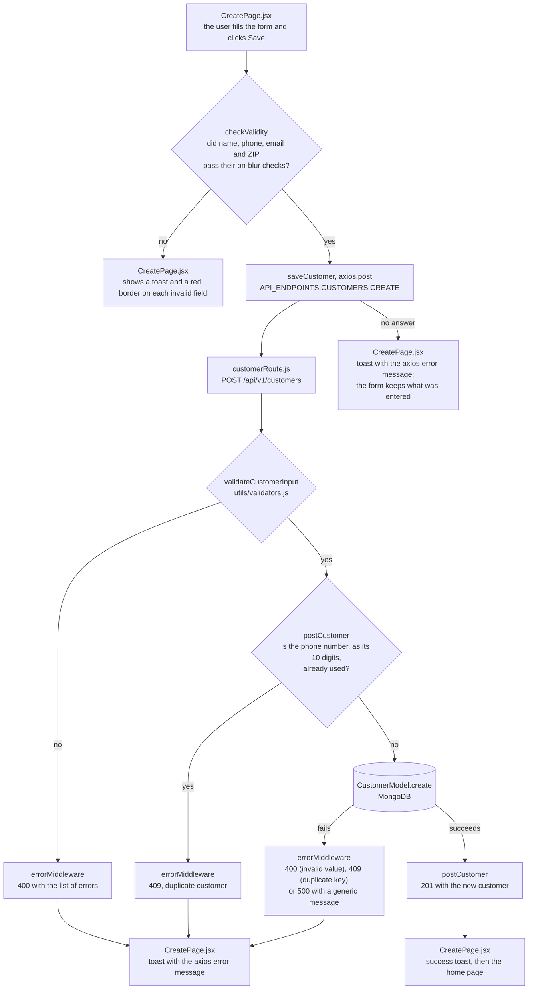
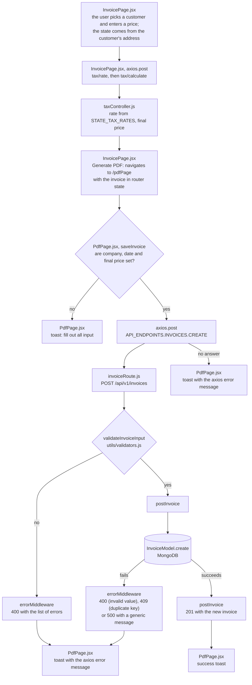

# Data Flow

Last updated: 2026-10-28

Every request to `/api/v1/` takes the same path: a page calls the API with axios, using a URL from `API_ENDPOINTS` (`FRONTEND/src/config/apiConfig.js`); an Express router under `/api/v1/` runs the validation middleware, where the route has one, then a controller wrapped in `express-async-handler`; the controller reads or writes through a Mongoose model, for customers and invoices, and answers with `{ success, data, message? }`. Any error a controller throws or passes on reaches `errorMiddleware`, which answers with `{ success: false, message, statusCode, errors? }`. It turns a Mongoose cast or validation error into 400 and a duplicate-key error into 409; any other unexpected error answers 500 with a generic message, and the real message is only logged.

## Save a new customer

Notes:
- The client and the server validate separately, with their own rules. The client requires email and ZIP, which the server accepts empty. The server rejects company names with characters such as `'` or accented letters, or longer than 100 characters, and states not given as two capital letters, all of which the client lets through: those saves end in a 400.
- The page shows `error.message` from axios, such as "Request failed with status code 409", not the `message` the API returns.
- Editing a customer (`EditPage.jsx`, `PUT /api/v1/customers/:id`) takes the same path through `validateCustomerInput` and `updateCustomer`, which also returns 404 when the customer does not exist.

## Save an invoice

Notes:
- The server computes the tax rate and the final price. The page sums the line items into the subtotal it sends, and shows a tax line it derives as subtotal × rate.
- The date of service travels as `YYYY-MM-DD` (ADR-013). `InvoicePage.jsx` enters it with a date picker and checks it with `isValidDateOfService` (`utils/date.js`, the server's rule); the invoice table and the PDF show it as `MM/DD/YYYY` by cutting the string. The server stores it as a date at UTC midnight and sends it back as `YYYY-MM-DD`.
- The invoice stores a copy of the customer's name, phone, email and address at the time it is saved. A later change to the customer does not change the invoice.
- Downloading the PDF (`saveFile` in `PdfPage.jsx`) happens in the browser with `@react-pdf/renderer` and does not call the API.
