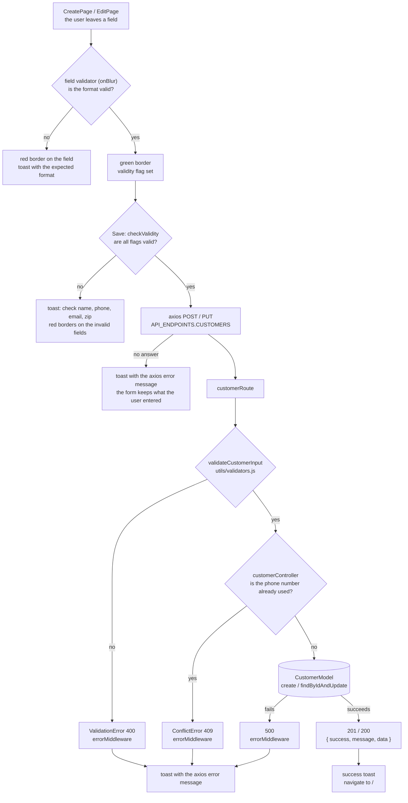
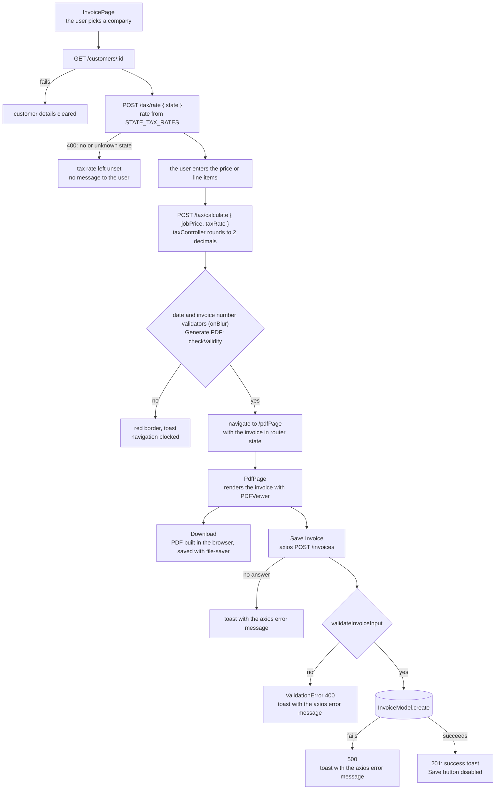

# Data Flow

Last updated: 2026-10-20

Every request goes from a page, through axios with a URL from `API_ENDPOINTS`, to an Express route, the validation middleware where there is one, a controller and a Mongoose model. Every error the API raises ends in `errorMiddleware` ([ADR-001](Decisions_Consistency.md#adr-001)).

## Save a customer

Creating (`CreatePage.jsx`, `POST /api/v1/customers`) and editing (`EditPage.jsx`, `PUT /api/v1/customers/:id`) follow the same path. An edit first loads the customer by ID, and its handler also answers 404 when the customer no longer exists.

Notes:
- The client and the server check different things. The client requires email and zip code; the server treats both as optional. The client and server phone patterns are not the same regex.
- An error toast shows axios's `error.message` ("Request failed with status code …"), not the `message` the API puts in its error envelope.
- After a create, the success toast reads `response.data.companyName`. The customer is under `response.data.data`, so the name is likely missing from the toast. **Needs the owner:** an open bug, or intended?
- A customer image left empty is replaced in the browser by a placeholder image URL on an external site before the request.

## Generate and save an invoice

Notes:
- The customer's contact and address fields are copied into the invoice when it is saved. The invoice keeps no reference to the customer ([ADR-005](Decisions_Consistency.md#adr-005)).
- The tax calls have no error handling of their own. A customer with no state, or a state not in `STATE_TAX_RATES`, leaves the tax rate unset without telling the user.
- The invoice number is checked only in the browser, against the last element of the invoice list. The API returns that list newest first, so the last element is the oldest invoice. With no invoices at all, the check has nothing to compare against. **Needs the owner:** confirm the intended check.
- The invoice data reaches `PdfPage` only through router state. Opening `/pdfPage` directly, or reloading it, leaves the page without an invoice.
- Downloading the PDF does not call the API; saving it does.

## Load and delete

- **Lists.** `HomePage` loads the customers (`GET /customers`, paginated, 20 by default) and all invoices (`GET /invoices`, newest first) on mount. `ProfilePage` loads one customer and the invoice list. Each page reads the payload defensively, as `response.data.data` with a fallback to `response.data`, and shows a toast on failure.
- **Delete.** `Customer`, `CustomerProfile`, `TableCustomer` and `TableInvoice` ask for confirmation with a sweetalert2 dialog, then call `DELETE /customers/:id` or `DELETE /invoices/:id`. A missing record answers 404 through `errorMiddleware`. Deleting a customer leaves their invoices in place, since an invoice holds its own copy of the customer's details.
- **IDs.** No route checks the ID format. An ID that is not a valid MongoDB ObjectId makes Mongoose throw a cast error with no status code, which `errorMiddleware` answers as 500.
