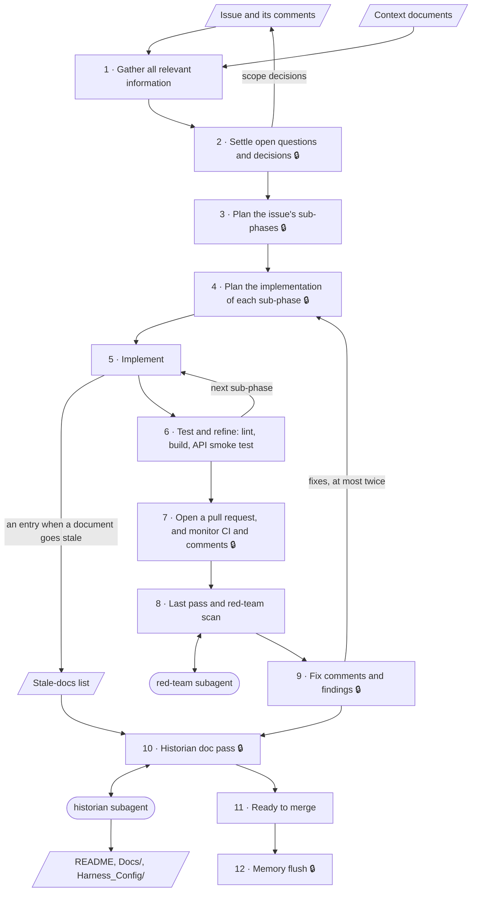

# Development Workflow

Last updated: 2026-10-20

Every issue goes through these stages, in order. Who decides, and how findings are triaged, is in [Working Agreements](Working_Agreements.md).

## Rules for every stage
- Do not jump a stage. Every open decision is settled before the sub-phase plan, and that plan before the implementation plans.
- The main session says which stage the work is in whenever it reports.
- Every stage ends with a report to the owner. A stage that ends with the owner's approval waits for it; the others go straight on.
- A scope change at any stage goes into the issue before it goes into the work.
- One issue, one branch, one pull request. When planning spans several issues, the planning documents get their own small pull request, merged before the first issue starts.
- Branches start from `master`. Branch names: `<type>/<issue>-<short-name>`, for example `feat/12-customer-search`. **Needs the owner:** confirm the naming.
- Commit messages follow Conventional Commits (`feat:`, `fix:`, `docs:`, `chore:`, …), one commit per sub-phase. Pull requests are squash-merged into `master`.

## The stages

| # | Stage | Owner's approval to move on |
|---|---|---|
| 1 | Gather all relevant information | No |
| 2 | Settle open questions and decisions | Yes: every open decision |
| 3 | Plan the issue's sub-phases | Yes: the sub-phase list |
| 4 | Plan the implementation of each sub-phase | Yes: every plan, and the go-ahead to implement |
| 5 | Implement | No |
| 6 | Test and refine | No |
| 7 | Open a pull request, and monitor CI and comments | Yes: the push and the pull request |
| 8 | Last pass and red-team scan | No |
| 9 | Fix comments and findings | Yes: what happens with each comment and finding |
| 10 | Historian doc pass | Yes: the documentation diff |
| 11 | Ready to merge | No: a note that the pull request is ready |
| 12 | Memory flush | Yes: the list of what to delete, condense and keep |

### 1. Gather all relevant information
- **What happens:** the main session reads the issue and its comments, the context documents ([AI Context](../AI_CONTEXT.md)), and the parts of InvoiceMe the issue touches. It checks the facts the issue states against the code as it is today.
- **Who acts:** the main session.
- **Produces:** a summary of what was found, any fact in the issue that turned out wrong, and the list of open decisions.
- **Owner's approval:** none.

### 2. Settle open questions and decisions
- **What happens:** the main session presents each open decision as options with a recommendation. The owner decides.
- **Who acts:** the main session recommends; the owner decides.
- **Produces:** the decided scope. Directional decisions are posted as a comment on the issue.
- **Owner's approval:** yes. Every open decision is settled, and the owner has approved the comment before it is posted.

### 3. Plan the issue's sub-phases
- **What happens:** the main session splits the issue into sub-phases small enough to review one at a time, and gives their order and the reason for it.
- **Who acts:** the main session.
- **Produces:** the sub-phase list, one commit per sub-phase.
- **Owner's approval:** yes. The owner approves the list, or reorders it.

### 4. Plan the implementation of each sub-phase
- **What happens:** for each sub-phase, the main session says which files change, how, and how the result will be verified. The stage repeats until every sub-phase has a plan; implementation starts only then.
- **Who acts:** the main session.
- **Produces:** an implementation plan per sub-phase.
- **Owner's approval:** yes. The owner's approval of the plans is the go-ahead to implement.

### 5. Implement
- **What happens:** the main session implements one sub-phase, as its plan says. Anything the plan does not cover stops for the owner. When a change makes a document untrue, the main session adds an entry to the stale-docs list at that moment.
- **Who acts:** the main session.
- **Produces:** the sub-phase's changes, and the running stale-docs list.
- **Owner's approval:** none.

### 6. Test and refine
- **What happens:** the main session runs the checks on the sub-phase and fixes what they show. There are no automated tests yet (Jest or Supertest is planned), so the checks are the ones CI runs:
  - `FRONTEND`: `npm run lint` (zero warnings allowed) and `npm run build`
  - `NODEAPI`: `node --check server.js`, and loading `app.js` without opening a database connection ([ADR-008](Decisions_Consistency.md#adr-008))

  A change to behaviour is also exercised in the running app (`npm run dev` from the root, with a MongoDB available). Once the checks pass, the main session commits the sub-phase and reports what changed, which files, and how it was verified. The next sub-phase starts at stage 5; after the last one, the work goes on to stage 7.
- **Who acts:** the main session.
- **Produces:** the verification results, and one commit per sub-phase.
- **Owner's approval:** none. The owner verifies the change at stage 7, before the push.

### 7. Open a pull request, and monitor CI and comments
- **What happens:** the owner verifies the change their own way. The main session pushes the branch and opens a pull request against `master` that links the issue, and turns on Auto-fix in Claude Code so that CI failures, merge conflicts and review comments wake it. It fixes CI failures and merge conflicts as they come, and confirms each push first. Review comments wait for the triage at stage 9.
- **Reviewers:** the `Node.js CI` workflow (frontend lint and build, API smoke test, on Node 22 and 24) and CodeQL.
- **Who acts:** the owner verifies; the main session acts after the owner confirms each action.
- **Produces:** the pull request, the CI result and the review comments.
- **Owner's approval:** yes. The owner is satisfied the change works, and confirms the push and the pull request, each before it happens.

### 8. Last pass and red-team scan
- **What happens:** once the pull request is open, the main session reads the whole change once more against the issue and its acceptance criteria. It then briefs the red-team subagent with the goal, the target and the constraints. On a loop back from stage 9, the scan runs again as a narrow re-review: the previous findings, the changed lines, and the side effects of the fixes.
- **Who acts:** the main session and the red-team subagent.
- **Produces:** the red-team's findings.
- **Owner's approval:** none. Skipping the scan for a small mechanical change needs the owner's approval.

### 9. Fix comments and findings
- **What happens:** the main session triages each review comment and each finding as [Working Agreements](Working_Agreements.md) describes, and recommends fixing or declining it. The owner decides. Each approved fix loops back to stage 4. The main session answers each review comment with its fix or the reason it was declined.
- **Who acts:** the main session recommends; the owner decides.
- **Produces:** a decision for each comment and finding, and replies to the comments.
- **Owner's approval:** yes.

### 10. Historian doc pass
- **What happens:** once the change is final, the main session briefs the historian subagent with the stale-docs list. The historian checks each entry against the repository, applies the listed entries, and reports anything else it finds without editing it. The owner reviews its diff.
- **Documents in scope:** the historian edits `README.md`, `Docs/` and `Harness_Config/`. It reports a stale `CLAUDE.md` without editing it; the main session updates that file after the owner's review.
- **Who acts:** the main session, the historian subagent and the owner.
- **Produces:** the historian's report, and one documentation commit made by the main session after the review.
- **Owner's approval:** yes. The owner approves the documentation diff and decides on each finding beyond the list.

### 11. Ready to merge
- **What happens:** the main session confirms that CI passes, every comment and finding is closed, and every acceptance criterion is met, and says so.
- **Who acts:** the main session reports; the owner squash-merges.
- **Produces:** the merged pull request and the closed issue.
- **Owner's approval:** none. The merge is the owner's.

### 12. Memory flush
- **What happens:** the main session goes through its persistent notes and the session's scratch files, and lists each as delete, condense or keep. Notes on finished work are condensed to the outcome, the deferred follow-ups and the lasting lessons.
- **Runs when:** an epic is closed out, or after an issue with no parent and no sibling issues.
- **Who acts:** the main session.
- **Owner's approval:** yes. The owner approves the list before anything is deleted or changed.

## Loops
- Stage 4 repeats for every sub-phase. Implementation starts only when every sub-phase is planned.
- Stages 5 and 6 repeat for every sub-phase. Each is implemented, checked and committed before the next starts.
- From stage 9 back to stage 4, for the fixes the owner approves: they go through stages 5 and 6, are pushed at stage 7, get a narrow re-review at stage 8, and return to stage 9. This loop runs at most twice; after that, the owner declines each remaining item or moves it to a follow-up issue. A third loop runs only if the owner asks for it.

## The workflow as a diagram

A lock 🔒 marks a stage that ends with the owner's approval.

**Needs the owner:** whether Dependabot pull requests go through these stages, or are merged on a green CI run.
