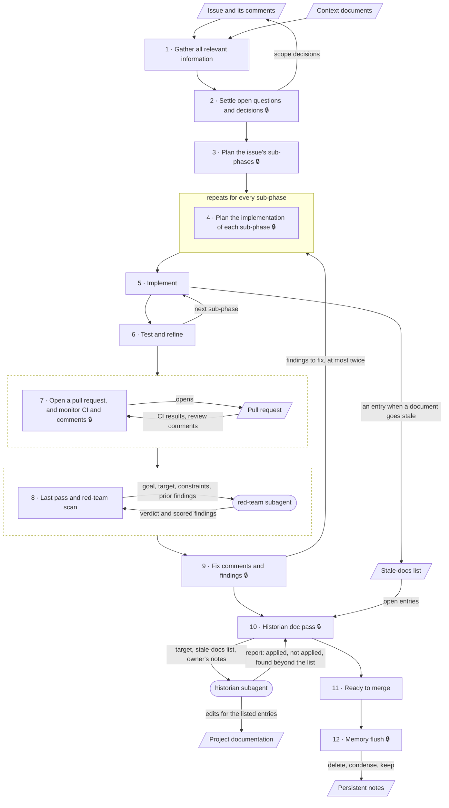

# Development Workflow

Every issue goes through these stages, in order, from gathering information to the memory flush. Who decides and how findings are triaged is in [Working Agreements](Working_Agreements.md).

## Rules for every stage

- Do not jump a stage. Every open decision is settled before the sub-phase plan, and that plan before the implementation plans.
- The main session says which stage the work is in whenever it reports.
- Every stage ends with a report to the owner. A stage that ends with the owner's approval waits for it; the others go straight on.
- A scope change at any stage goes into the issue before it goes into the work.
- One issue, one branch, one pull request into `master`. When planning spans several issues, the planning documents get their own small pull request, merged before the first issue starts.

## The stages

| # | Stage | Owner's approval to move on |
|---|---|---|
| 1 | Gather all relevant information | No |
| 2 | Settle open questions and decisions | Yes: every open decision |
| 3 | Plan the issue's sub-phases | Yes: the sub-phase list |
| 4 | Plan the implementation of each sub-phase | Yes: every plan, and the go-ahead to implement |
| 5 | Implement | No |
| 6 | Test and refine | No |
| 7 | Open a pull request, and monitor CI and comments | Yes: the push and the pull request |
| 8 | Last pass and red-team scan | No |
| 9 | Fix comments and findings | Yes: what happens with each comment and finding |
| 10 | Historian doc pass | Yes: the documentation diff |
| 11 | Ready to merge | No: a note that the pull request is ready |
| 12 | Memory flush | Yes: the list of what to delete, condense and keep |

### 1. Gather all relevant information

- **What happens:** the main session reads the issue and its comments, the context documents, and the parts of the project the issue touches. It checks the facts the issue states against the project as it is today.
- **Who acts:** the main session.
- **Produces:** a summary of what was found, any fact in the issue that turned out wrong, and the list of open decisions.
- **Owner's approval:** none. The main session reports the summary and goes on to stage 2.

### 2. Settle open questions and decisions

- **What happens:** the main session presents each open decision as options with a recommendation, as described in [Working Agreements](Working_Agreements.md). The owner decides.
- **Who acts:** the main session recommends; the owner decides.
- **Produces:** the decided scope. Directional decisions are posted as a comment on the issue.
- **Owner's approval:** yes. Every open decision is settled, and the owner has approved the comment before it is posted.

### 3. Plan the issue's sub-phases

- **What happens:** the main session splits the issue into sub-phases small enough to review one at a time, and gives their order and the reason for it.
- **Who acts:** the main session.
- **Produces:** the sub-phase list, one commit per sub-phase.
- **Owner's approval:** yes. The owner approves the sub-phase list, or reorders it.

### 4. Plan the implementation of each sub-phase

- **What happens:** for each sub-phase, the main session says which files change, how, and how the result will be verified. The stage repeats until every sub-phase has a plan; implementation starts only then.
- **Who acts:** the main session.
- **Produces:** an implementation plan per sub-phase.
- **Owner's approval:** yes. The owner approves the plans, and that approval is the go-ahead to implement.

### 5. Implement

- **What happens:** the main session implements one sub-phase, as its plan says. Anything the plan does not cover stops for the owner ([Working Agreements](Working_Agreements.md), "Who decides", rule 5). When a change makes a document untrue, the main session adds an entry to the stale-docs list at that moment. The list lives in `.claude/stale-docs.md`, kept out of version control, when the work spans several sessions, and in the session when the issue is finished in one sitting.
- **Who acts:** the main session.
- **Produces:** the sub-phase's changes, and the running stale-docs list.
- **Owner's approval:** none. The sub-phase goes straight to stage 6.

### 6. Test and refine

- **What happens:** the main session runs the project's checks on the sub-phase (listed in the agent guidance file, `.claude/CLAUDE.md`), and fixes what they show. Once they pass, it commits the sub-phase and reports it: what changed, which files, how it was verified. The next sub-phase starts at stage 5; after the last one, the work goes on to stage 7.
- **Who acts:** the main session.
- **Produces:** the verification results, and one commit per sub-phase.
- **Owner's approval:** none. The owner verifies the change at stage 7, before the push.

### 7. Open a pull request, and monitor CI and comments

- **What happens:** the owner verifies the change their own way. The main session pushes the branch and opens a pull request that links the issue, and turns on Auto-fix in Claude Code, so that CI failures, merge conflicts and review comments wake it. The reviewers on a pull request are the "Node.js CI" workflow (frontend lint and build, API syntax and load check) and CodeQL. The main session fixes CI failures and merge conflicts as they come, and confirms each push first. Review comments, including those from automated reviewers, wait for the triage at stage 9.
- **Who acts:** the owner verifies; the main session acts after the owner confirms each action.
- **Produces:** the pull request, the CI result and the review comments.
- **Owner's approval:** yes. The owner is satisfied the change works, and confirms the push and the pull request, each before it happens.

### 8. Last pass and red-team scan

- **What happens:** it starts as soon as the pull request is verified open. The main session reads the whole change once more against the issue and its acceptance criteria. It then briefs the red-team subagent with the goal, the target and the constraints. The red-team reviews the change with no knowledge of the session and returns scored findings. On a loop back from stage 9, the scan runs again as a narrow re-review: the previous findings, the changed lines and the side effects of the fixes.
- **Who acts:** the main session and the red-team subagent.
- **Produces:** the red-team's findings.
- **Owner's approval:** none. The findings go to stage 9. If the main session proposes skipping the scan for a small mechanical change, the owner approves the skip, unless the owner has delegated that judgment ([Working Agreements](Working_Agreements.md), "Who decides", rule 9).

### 9. Fix comments and findings

- **What happens:** the main session triages each review comment and each finding as described in [Working Agreements](Working_Agreements.md), and recommends fixing or declining it. The owner decides. The fixes loop back to stage 4, with an implementation plan for each one (see [Loops](#loops)). The main session answers each review comment with its fix or the reason it was declined. With nothing left to fix, the work goes on to stage 10.
- **Who acts:** the main session recommends; the owner decides.
- **Produces:** a recommendation and the owner's decision for each comment and finding, and replies to the comments.
- **Owner's approval:** yes. The owner decides what happens with each comment and finding.

### 10. Historian doc pass

- **What happens:** once the change is final, the main session briefs the historian subagent with the stale-docs list. The historian checks each entry against the repository, applies the listed entries, and reports anything else it finds without editing it. The owner reviews its diff against the list and the change. The documents in scope are `README.md`, `Docs/`, `Harness_Config/`, `.claude/CLAUDE.md` and `NODEAPI/.env.example`.
- **Who acts:** the main session, the historian subagent and the owner.
- **Produces:** the historian's report, and one documentation commit made by the main session after the review.
- **Owner's approval:** yes. The owner approves the documentation diff and decides on each finding beyond the list.

### 11. Ready to merge

- **What happens:** the main session confirms that CI passes, every comment and finding is closed, and every acceptance criterion is met, and says so.
- **Who acts:** the main session reports; the owner merges.
- **Produces:** the merged pull request and the closed issue.
- **Owner's approval:** none. The main session notes that the pull request is ready; the merge is the owner's. Stage 12, when it runs, starts after the merge.

### 12. Memory flush

- **What happens:** the main session goes through its persistent notes and the session's scratch files, and lists each as delete, condense or keep. Notes on finished work are condensed to the outcome, the deferred follow-ups and the lasting lessons.
- **Who acts:** the main session.
- **Produces:** a shorter set of notes for the next session to start from.
- **Owner's approval:** yes. The owner approves the list before anything is deleted or changed.

This stage runs only when an epic is closed out, or after an issue that has no parent and no sibling issues. A sub-issue of an open epic gets no flush; its notes wait for the close-out.

## Loops

The stages run in order, with three loops:

1. **Stage 4, for every sub-phase.** Each sub-phase from stage 3 gets its implementation plan. Implementation starts only when every sub-phase is planned.
2. **Stages 5 and 6, for every sub-phase.** Each sub-phase is implemented, checked and committed before the next one starts.
3. **From stage 9 back to stage 4, for the fixes.** Each fix the owner approves at stage 9 gets an implementation plan at stage 4. The fixes go through stages 5 and 6, are pushed to the open pull request at stage 7, get a narrow re-review at stage 8, and return to stage 9. A small mechanical fix may skip the re-review, as at stage 8. This loop runs at most twice. After the second loop, the main session lists what remains, and the owner declines each item or moves it to a follow-up issue. A third loop runs only if the owner asks for it.

The red-team keeps its own limit: it reviews the same change at most twice.

## The workflow as a diagram

Boxes are stages, rounded shapes are subagents, and slanted shapes are documents. A lock 🔒 marks a stage that ends with the owner's approval. Stage 4 sits in a frame because it repeats for every sub-phase; the arrows labelled "next sub-phase" and "findings to fix" are the other loops. Stages 7 and 8 sit in dashed frames with the document or subagent they work with.

What each subagent receives and returns:

| Subagent | Runs at | Receives | Returns |
|---|---|---|---|
| red-team | Stage 8, on the finished change, and again on a loop's fixes | The goal (the issue and its decided scope), the target (branch, commit range, pull request or design document), the constraints (what is out of scope), and prior findings on a re-review | A verdict and scored findings, each with evidence. It edits nothing. |
| historian | Stage 10, once the change is final | The target, the stale-docs list, any rule candidates, and the owner's notes on entries already rejected or changed | Edits for the listed entries, and a report: what it applied, what it did not apply and why, and what it found beyond the list. It edits nothing beyond the list and never commits. |
